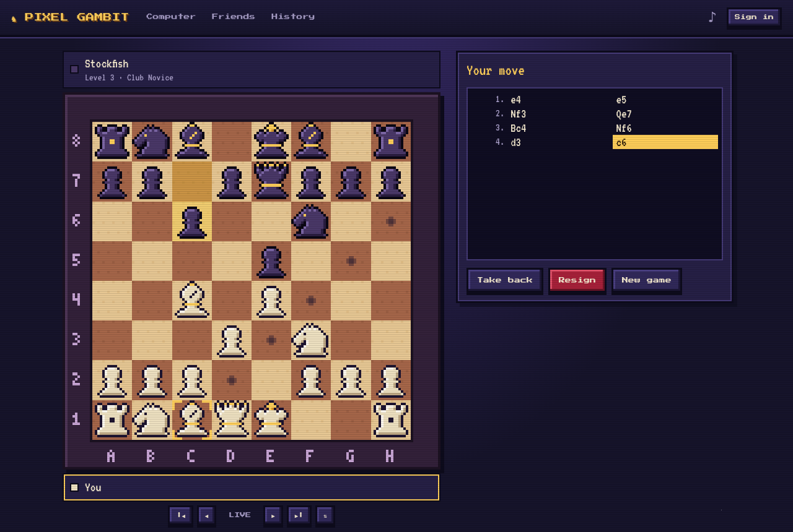

# Pixel Gambit



*Chess, 8-bit style.* Play Stockfish at eight strengths, challenge a friend by email and play at your own pace, or pass one screen between two players. Hand-drawn pixel pieces, a wooden board with a little grain, square-wave sound.

Pixel Gambit is an original game: chess's rules are nobody's, and its name, art, sounds and code are its own. The computer opponent is [Stockfish](https://stockfishchess.org/) (via [stockfish.js](https://github.com/nmrugg/stockfish.js), GPL-3.0) and the move rules come from [chess.js](https://github.com/jhlywa/chess.js) (BSD-2-Clause).

It will live at <https://games.icelander.net/retro/chess/> once deployed (see **Deploy**: it needs a database and sign-in keys first).

## How to play

- **VS COMPUTER.** Pick a strength and a colour. Stockfish runs in your browser, so this works without signing in, and even offline once the page is loaded. Your game is kept in the browser, so a reload carries on where you were. **Take back** undoes your last move and the computer's answer.
- **VS A FRIEND.** Sign in with Google or GitHub, type a friend's email address and choose your colour. If they already play, the challenge is in their lobby; if not, it waits for them to sign in with that address, and you get a link to send them (and, when email sending is set up, they get an email). Once they accept, the game is on: moves appear on both screens at once, and either of you can close the page and come back days later. **Offer draw**, **Resign** and, afterwards, **Rematch** (colours swapped).
- **PASS & PLAY.** Two players on one device. **Undo** takes back one move.

Moving: tap or click a piece, then where it goes (dots show the moves, corner marks show captures), or drag it. On a keyboard: focus the board, move the cursor with the arrow keys, Enter picks up and puts down; for a promotion press 1–4 (queen, rook, bishop, knight). Under the board, ◀ ▶ step through the game (arrow keys too) and ⇅ turns the board around. Clicking a move in the list shows that position.

**Contacts.** Everyone you challenge or who challenges you is kept in your contacts, with your record against them (wins, losses, draws). You can add and remove contacts, and challenge one with a click.

**History.** Every finished game, against friends or the computer, with a replay of each one. Signed out, games against the computer are kept on this device instead.

### The computer's strengths

| | Name | Stockfish Skill Level | Search |
|---|---|---|---|
| 1 | Pawn Pusher | 0 | depth 1 |
| 2 | Weekend Wood | 3 | depth 2 |
| 3 | Club Novice | 6 | depth 4 |
| 4 | Café Regular | 9 | depth 6 |
| 5 | Club Captain | 12 | depth 9 |
| 6 | County Champ | 15 | depth 12 |
| 7 | Master | 18 | 1 second |
| 8 | The Machine | 20 | 2 seconds |

The ratings shown on the set-up screen are rough guides, not measured.

## How it works

```
src/                 the browser
  main.ts            screens and routing: title, set-up, lobby, history, sign-in
  modes.ts           computer, pass & play, online, replay
  game.ts            the game screen: board, name plates, captured pieces, move list
  board.ts           the canvas board: drawing, animation, mouse/touch/keyboard input, promotion picker
  sprites.ts         the pixel-art pieces and a 3×5 font for coordinates
  engine.ts          Stockfish in a Web Worker, and the eight strengths
  api.ts, sound.ts, ui.ts
  shared/            used by both sides: rules.ts (results from chess.js) and protocol.ts (the API's types)
worker/              the Cloudflare Worker
  index.ts           routes /retro/chess/api/* and /auth/*; everything else is static
  auth.ts            Google and GitHub OAuth (authorization code + PKCE), sessions
  api.ts             lobby, challenges, contacts, games, history
  room.ts            a Durable Object per online game: one action at a time, live WebSocket updates
  actions.ts         what a move, resignation or draw offer does to a game (pure, tested)
  db.ts, mail.ts, schema.sql
```

- **Who you are.** Your verified email address, from Google or GitHub; the same address through either is the same player. Only a hash of the session token is stored. The session cookie is `HttpOnly`, `SameSite=Lax` and limited to `/retro/chess`; writes must be JSON from this origin.
- **The server decides.** Every online move goes through the game's Durable Object, which checks it's your turn and the move is legal (with the same `src/shared/rules.ts` the browser uses), saves it in D1 and sends the new game to both players over WebSockets (hibernating between moves, so idle games cost nothing). The browser shows your move at once and the server confirms it, or puts the board back. Games against the computer are checked too before they go into your history: the moves must be legal and the game over.
- **What is stored:** users (email, name), sessions, challenges (to an email address), games (moves and result) and contacts (email, optional name). No other personal data.

## Develop

```bash
npm install
npm test                 # typecheck, then rules, actions, sprites and the whole API on an in-memory SQLite
cp .dev.vars.example .dev.vars          # DEV_LOGIN=1: sign in as any email, for testing two players
npx wrangler d1 execute chess --local --file worker/schema.sql
npm run dev              # builds, then wrangler dev at http://localhost:8787/retro/chess/
```

With `DEV_LOGIN=1` the sign-in screen offers a "dev sign-in" that takes any address; use two browsers (or a private window) to play yourself. Never set it in production.

## Deploy

One-time set-up (owner actions):

1. `npx wrangler d1 create chess`, put the id in `wrangler.jsonc`, then `npx wrangler d1 execute chess --remote --file worker/schema.sql`.
2. **Google:** in Google Cloud Console → APIs & Services → Credentials, create an OAuth client ID (Web application) with the redirect URI `https://games.icelander.net/retro/chess/auth/callback/google`. **GitHub:** Settings → Developer settings → OAuth Apps, callback URL `https://games.icelander.net/retro/chess/auth/callback/github`. Then `npx wrangler secret put` each of `GOOGLE_CLIENT_ID`, `GOOGLE_CLIENT_SECRET`, `GITHUB_CLIENT_ID`, `GITHUB_CLIENT_SECRET`. Either provider alone is enough; the sign-in screen shows those that are set up.
3. Optional, to email challenges: a [Resend](https://resend.com) API key (`npx wrangler secret put RESEND_API_KEY`) and a verified sender in `MAIL_FROM` in `wrangler.jsonc`. Without it challenges still work; the challenger sends the link.

Then `npm run deploy`.

## Credits and licences

Pixel Gambit's code and art are MPL-2.0, like the rest of this repository. It ships Stockfish 19 (lite, single-threaded WebAssembly build from stockfish.js), which is GPL-3.0; its licence is served beside it at `engine/COPYING.txt`, and its source is at <https://github.com/nmrugg/stockfish.js>. The fonts Press Start 2P (CodeMan38) and VT323 (Peter Hull) are SIL OFL 1.1, with their licences in `fonts/`. chess.js is BSD-2-Clause.
