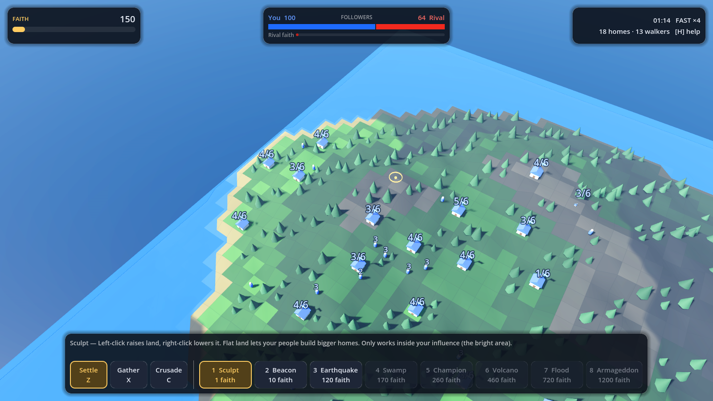

# Hand of the Isle



An original god game made in Godot 4: you don't command your followers directly. You reshape the island they live on
and call down divine powers, while a rival deity does the same under the same rules and costs. Everything (terrain,
buildings, people, interface) is generated in code; there are no external assets.

It lives at <https://icelander.net/games/fresh/hand-of-the-isle/>, **for invited players only**: every file, the landing
page included, is served only to someone signed in to icelander.net who holds the role `games:hand-of-the-isle`. The
role is declared in the icelander.net repository (`accounts/src/config.js`) and granted, or sent as an invitation, at
<https://icelander.net/private/admin>. The games page and the front page list Hand of the Isle only to holders of the
role. It is played in the browser only: Godot's web export, on the Compatibility renderer (WebGL 2).

## How it plays

- **Flat land is everything.** A walker that finds a flat, dry, unclaimed tile builds a home.
  The more flat land at the same height around it, the larger the home grows:
  **Hut** (1×1, 6 people) → **House** (3×3, 18) → **Castle** (5×5, 44).
- **Homes breed followers.** A full home sends out a walker carrying half its people.
- **Followers produce faith**, bigger homes more per person. Faith pays for everything.
- **Influence.** You can only sculpt near your own people — the bright part of the island.
  The rest is dimmed.
- Homes whose ground is no longer flat collapse (half the people survive); homes under the
  sea drown.
- You win when the rival has no people left.

### Follower behaviour (Z / X / C)

| | |
|---|---|
| **Settle** | Seek flat land, build, and join unfilled homes |
| **Gather** | March to your Beacon and merge into one strong band |
| **Crusade** | Hunt the rival's walkers and besiege their homes |

### Powers (1–8)

| Power | Faith | Effect |
|---|---|---|
| Sculpt | 1 | Left-click raises a corner, right-click lowers it; neighbours follow so slopes stay gentle |
| Beacon | 10 | Rally point for Gather |
| Earthquake | 120 | Scrambles the ground in a radius, toppling homes |
| Swamp | 170 | Bogs on flat ground that swallow walkers; reshaping clears them |
| Champion | 260 | Your strongest walker becomes a haloed hero who crusades on its own |
| Volcano | 460 | Raises a mountain strewn with unbuildable rock |
| Flood | 720 | Raises the sea one step everywhere — both sides suffer |
| Armageddon | 1200 | Every home empties and both peoples march to a final battle |

Hold **Shift** while casting to keep the power selected.

### Controls

| Input | Action |
|---|---|
| Left / right mouse (hold to repeat) | Raise / lower land, or cast the selected power |
| W A S D / arrows | Pan |
| Q / E, middle-drag | Rotate |
| Mouse wheel | Zoom |
| Space | Pause |
| F | Fast-forward ×3 |
| Home | Centre on your people |
| Esc | Back to Sculpt / close help |
| H | Help |

## How it works

```
godot/                      the game (Godot 4.7; Compatibility renderer in the browser)
  main.tscn                 the one scene; its root runs scripts/main.gd
  scripts/main.gd           scene dressing (sky, sun, sea), input, cursor, game states, command-line test switches
  scripts/world.gd          the simulation: settlements, walkers, combat, faith, influence, the eight powers
  scripts/terrain.gd        heightmap, sculpting, the low-poly mesh, water and trees
  scripts/terrain.gdshader  vertex-colour terrain with the influence overlay and tile grid
  scripts/settlement.gd, walker.gd   homes and followers, and their models
  scripts/rival_ai.gd       the rival deity: the same rules and costs as the player
  scripts/camera_rig.gd     the orbiting tabletop camera
  scripts/hud.gd            the interface, built in code
  tests/selftest.gd         headless test: the island, sculpting and its limits, two powers, a whole match
  web_shell/shell.html      the page the web export runs in (no inline script: the CSP forbids it)
  export_presets.cfg        Web
web/                        the landing page, the play page's stylesheet and boot script, the icon, _headers
docs/                       the landing page's screenshots
worker/index.ts             the Worker: games:hand-of-the-isle on every file but the stylesheet and icon; joins the engine's parts
worker/config.ts            the game's path and role
test/worker.test.ts         who may fetch what, and the joining of parts
build.mjs                   exports the game into dist/ and cuts the engine into parts
```

Cloudflare serves static files of at most 25 MiB. The engine (`index.wasm`, about 40 MB) is stored as 20 MiB parts
(`index.wasm.0`, `index.wasm.1`), and the Worker streams the parts back as one file, as Iron Haze does.

Tunable numbers live at the top of `godot/scripts/world.gd` (`POWERS`, `WALKER_CAP`, `MANA_MAX`), in
`Settlement.CAP`, and in `RivalAI` (think rate, sculpt budget, crusade grace period per difficulty).

## Commands

Requires Node 22, and Godot 4.7.2 with its web export templates for the build (set `GODOT` to its path if it isn't on
the PATH as `godot`).

| Command | What it does |
|---|---|
| `npm test` | Typecheck and the Worker's tests |
| `npm run test:godot` | Import the project and run the headless self-test |
| `npm run build` | The landing page and the web export, into `dist/` |
| `npm run dev` | `build`, then `wrangler dev`. For the stand-in sign-in put `DEV_LOGIN="1"` in `.dev.vars` and run `npx wrangler dev --local-upstream localhost:8787`, with a `site_session` cookie of `dev.` and base64url JSON such as `{"email":"you@example.com","roles":["games:hand-of-the-isle"]}` |
| `npm run deploy` | Test, build and deploy by hand (normally the merge to `main` does it) |

To play it locally without the Worker, open `godot/project.godot` in Godot 4.7 and press F5.

Test switches for the Godot project, after `--` on its command line:
`--autoplay` (the rival AI plays both sides and logs the balance every 30 s; combine with `--headless`),
`--play` (skip the title), `--level=0..2`, `--seed=N`, `--speed=N`, `--zoom=N --focus=red`,
`--shot=out.png --shot-time=S` (save a screenshot and quit), `--click-test`, `--quit-after=S`.

```sh
godot --headless --path godot -- --autoplay --speed=20 --quit-after=60
```

## Deploy

A merge to `main` that changes this folder deploys it (`.github/workflows/deploy.yml`, which installs Godot 4.7.2 and
its export templates for the Godot games). The Worker needs no database and no secrets: only the route
`icelander.net/games/fresh/hand-of-the-isle*` and the service binding to the login service, both in `wrangler.jsonc`.
