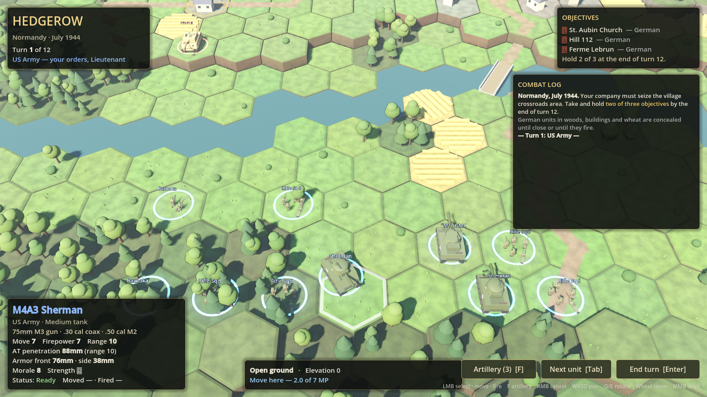

# Hedgerow



*Normandy, July 1944.* A new single-player, turn-based WWII tactics game in the spirit of Squad Leader, made in Godot 4 for the web. You command a US rifle company with armour support against a German position; the computer commands the Germans. Hex tiles stepped by elevation, 3D pieces modelled on the real vehicles and weapons, and no imported assets: everything is built in code.

It lives at <https://icelander.net/games/retro/hedgerow/>. Like every game on icelander.net/games it needs a sign-in, with Google or GitHub, through icelander.net's login service.

## How to play

Take and hold **two of the three objectives** (St. Aubin Church, Hill 112, Ferme Lebrun) at the end of turn 12, or destroy every German unit.

| Input | Action |
|---|---|
| Left click | Select a unit · move to a highlighted hex · fire at a red-ringed enemy |
| Right click / Esc | Cancel |
| Tab | Next unit that can still act |
| F1 or H | Help: the controls and the basics |
| F | Artillery: three 105mm fire missions, one per turn at most |
| Enter | End turn |
| WASD / arrows, Q / E, wheel | Pan, rotate, zoom (middle drag orbits; Shift+middle drag pans) |

Hover over an enemy with a unit selected to see the exact odds before firing.

## Rules

- **Each turn** a unit may move, then fire (−2 after moving), but not move after firing.
- **Opportunity fire.** Units that didn't fire in their own turn shoot at enemies that move into view in the opponent's turn (+2 against targets moving in the open).
- **Infantry fire** is firepower + modifiers + 2d6: 16+ casualty and morale check, 13–15 morale check, 11–12 pinned. Cover: woods −1, buildings −2; long range −1, point blank +2, firing downhill +1, HE against buildings +2, +1 for each earlier attack on the same target this turn.
- **Morale.** A failed check breaks the unit: it can't fire, and failing again costs a step. Broken units try to rally at the start of their turn.
- **Anti-tank fire** is a to-hit roll, then penetration (mm, falling with range) against the front, side or rear armour the shot strikes.
- **Line of sight** follows the elevation levels (0–3); woods and buildings block one level above their hex.
- **Concealment.** Germans in woods, buildings or wheat are seen only within 4–6 hexes, until they move or fire.
- **Reinforcements.** A Panther and a grenadier squad come down the north road on turn 5.

The units and their numbers are in `godot/scripts/unit_data.gd`: M4A3 Sherman, M10 Wolverine, 57mm AT gun, rifle squads, .30 cal MG sections and bazooka teams against Pz IV H, StuG III G, Panther G, 7.5cm PaK 40, grenadier squads, MG 42 teams and a Panzerschreck team.

## How it works

```
godot/                  the game (Godot 4.7, GDScript, Compatibility renderer for WebGL 2)
  scripts/main.gd       turns, input, moving and firing, opportunity fire, artillery, objectives, victory
  scripts/map.gd        map generation, terrain, line of sight, the 3D diorama and overlays (hex.gd: hex maths)
  scripts/combat.gd     the fire tables, morale, to-hit, penetration and armour facing, and the odds
  scripts/ai.gd         the computer opponent: scores each reachable hex, then fires or moves and fires
  scripts/unit.gd       a piece: state and animation; unit_data.gd: the units; models.gd: their 3D models
  scripts/ui.gd, camera_rig.gd, fx.gd   the HUD, the camera, the effects
  web_shell/shell.html  the page the web export runs in
web/                    boot.js (starts the engine), shell.css, favicon.svg, _headers
worker/index.ts         the Cloudflare Worker: the page behind the sign-in, the joined engine file, static assets
test/                   the Worker's tests
```

The game keeps nothing on a server: no API, no database, no high scores. Godot's WebAssembly engine is larger than the 25 MiB Cloudflare allows for a static file, so the build stores it as `index.wasm.0` and `index.wasm.1` and the Worker streams them back as one `index.wasm`, as Gambit does.

## Develop

You need Node 22 and [Godot 4.7.2](https://godotengine.org/download) with its web export templates (set `GODOT` to its path if it isn't on the PATH as `godot`).

```bash
npm install
npm test                 # the Worker
npm run test:godot       # a whole game, computer against computer, at 25× speed; fails if it doesn't finish
npm run dev              # exports the game, then wrangler dev at http://localhost:8787/games/retro/hedgerow/
```

Run it from the Godot editor with `godot/project.godot`.

## Deploy

A merge to `main` that changes this folder deploys it (the repository README, "Deploying"). By hand: `npm run deploy`. No database, secrets or one-time set-up.
