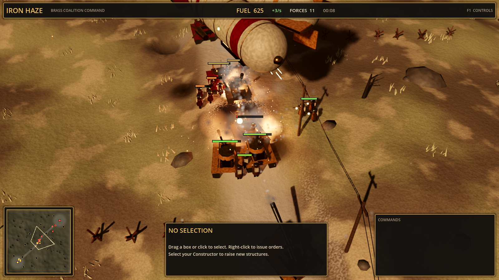
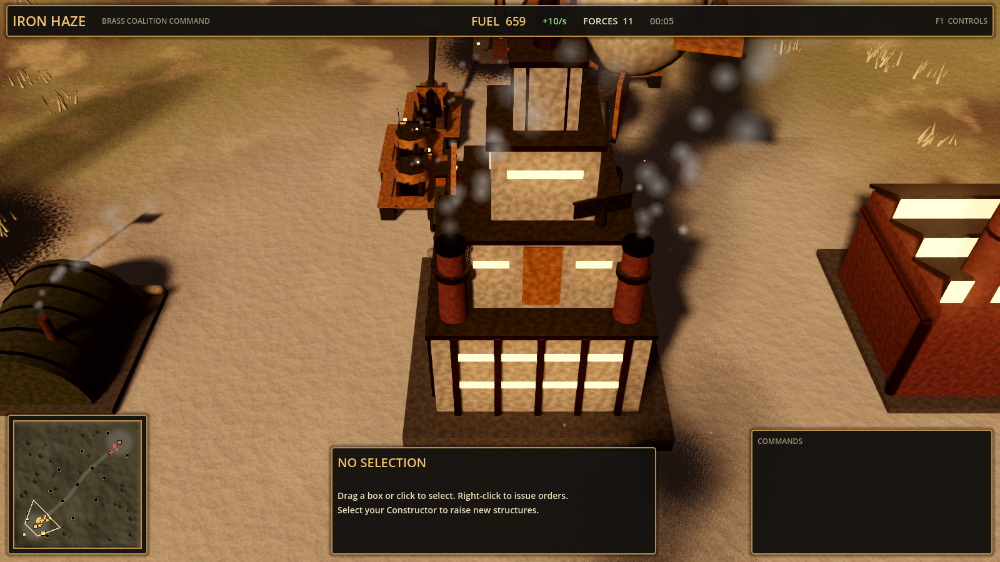

# Iron Haze



A dieselpunk real-time strategy game made in Godot 4. Pump crude from the oil wells, raise riveted ironclads, siege
howitzers and bomber zeppelins, and break the Iron Dominion, a build-order AI that expands, defends and attacks in
growing waves.

It lives at <https://icelander.net/games/fresh/iron-haze/>, **for invited players only**: every file, the landing page
included, is served only to someone signed in to icelander.net who holds the role `games:iron-haze`. The role is
declared in the icelander.net repository (`accounts/src/config.js`) and granted, or sent as an invitation, at
<https://icelander.net/private/admin>. The games page and the front page list Iron Haze only to holders of the role.

It is played two ways:

- **In the browser** (`/games/fresh/iron-haze/play/`): Godot's web export, on the Compatibility renderer (WebGL 2).
  Volumetric fog, SSAO and scorch decals don't exist there, so the game uses a denser plain fog instead
  (`Game.compat`).
- **As a download** (`/games/fresh/iron-haze/download/`): Windows (x86_64), macOS (universal) and Linux (x86_64)
  builds on the Forward+ renderer, with the full volumetric haze, ambient occlusion and scorch marks. They aren't
  code-signed.

There are no art assets: every unit, structure and prop is assembled in code from primitives with PBR materials, the
ground is a shader, and the effects are GPU particles on generated textures.



## How to play

| | |
|---|---|
| Fuel | Select the Constructor and build Pump Jacks (Z) on the dark oil wells. Every structure extends how far you can build. |
| Army | Barracks (X): Gasmask Troopers, who also shoot airships. War Factory (C): Ironclad Tanks and Thunderer Howitzers. Airship Mast (V): Stormcloud Zeppelins. Flak Towers (B) shred airships. |
| Win | Destroy every enemy structure. |
| Camera | Arrow keys or the screen edge, wheel to zoom, Q / E or middle-drag to rotate, H for the headquarters. |
| Orders | Left-click or drag to select (Shift adds, double-click selects a type); right-click to move, attack, assist construction or set a rally point; A then click to attack-move; S to stop; Ctrl+0–9 / 0–9 for groups; Ctrl+A for every combat unit. |
| Manual | F1 or ? in the game. F2 switches the desktop build between the full graphics and a quicker mode. |

Balance lives in `godot/scripts/game.gd` (`UNITS`, `BUILDINGS`, `DAMAGE`).

## How it works

```
godot/                    the game (Godot 4.7; Forward+ on the desktop, Compatibility on the web)
  scripts/game.gd         autoload Game: definitions, damage table, economy, spatial hash, placement, victory
  scripts/fx.gd           autoload FX: smoke, fire, explosions, decals, markers
  scripts/main.gd         the world: lighting and atmosphere, terrain mesh, props, spawning, weapons, dev flags
  scripts/models.gd       every unit and structure, built from primitives, and the materials
  scripts/entity.gd, unit.gd, building.gd, projectile.gd   what is on the battlefield
  scripts/player_controller.gd, rts_camera.gd, hud.gd, overlay.gd, minimap.gd   the player's side
  scripts/enemy_ai.gd     the Iron Dominion
  shaders/terrain.gdshader   the ground: mud, grass and rock, with oil, scorch and gravel painted in
  tests/selftest.gd       headless test of the player's commands: placing, building, orders, picking, combat
  web_shell/shell.html    the page the web export runs in (no inline script: the CSP forbids it)
  export_presets.cfg      Web, Linux, Windows and macOS
web/                      the landing page, the play page's stylesheet and boot script, the icon, _headers
worker/index.ts           the Worker: games:iron-haze on every file but the stylesheet and icon; joins parted files
worker/config.ts          the game's path and role
test/worker.test.ts       who may fetch what, and the joining of parts
build.mjs                 exports everything into dist/, zips the desktop builds and cuts large files into parts
```

Cloudflare serves static files of at most 25 MiB. The engine (`index.wasm`, about 40 MB) and the desktop zips (27 to
60 MB) are stored as 20 MiB parts (`name.0`, `name.1`, …), and the Worker streams the parts back as one file, as
Gambit does with its engine.

## Commands

Requires Node 22, and Godot 4.7.2 with its export templates for the builds (set `GODOT` to its path if it isn't on
the PATH as `godot`).

| Command | What it does |
|---|---|
| `npm test` | Typecheck and the Worker's tests |
| `npm run test:godot` | Import the project and run the headless self-test |
| `npm run build` | The landing page, the web export and the three desktop builds, into `dist/` |
| `npm run build:web` | The landing page and the web export only |
| `npm run dev` | `build:web`, then `wrangler dev`. For the stand-in sign-in put `DEV_LOGIN="1"` in `.dev.vars` and run `npx wrangler dev --local-upstream localhost:8787`, with a `site_session` cookie of `dev.` and base64url JSON such as `{"email":"you@example.com","roles":["games:iron-haze"]}` |
| `npm run deploy` | Test, build and deploy by hand (normally the merge to `main` does it) |

Developer flags for the Godot project, after `--` on its command line: `--demo` (two armies clash mid-map),
`--gallery` (one of everything by your base), `--aivsai --report` (an AI plays your side; the economy is printed
every 15 s), `--cam=x,z,zoom`, `--select=<kind>`, and `--shot=file.png --shotdelay=N`.

## Deploy

A merge to `main` that changes this folder deploys it (`.github/workflows/deploy.yml`, which installs Godot 4.7.2 and
its export templates for the Godot games). The Worker needs no database and no secrets: only the route
`icelander.net/games/fresh/iron-haze*` and the service binding to the login service, both in `wrangler.jsonc`.
