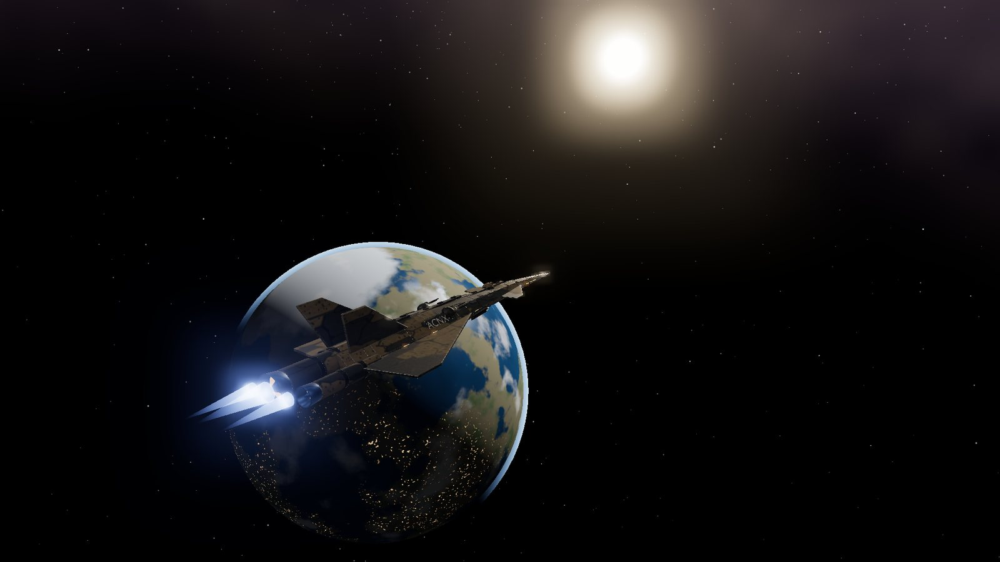
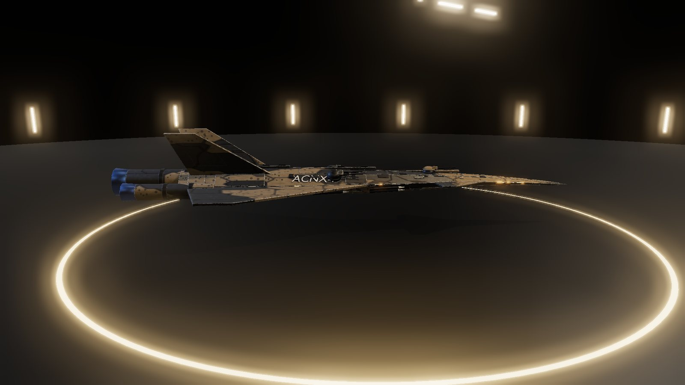
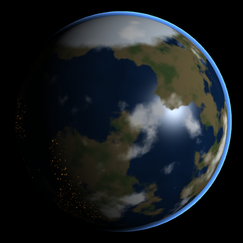
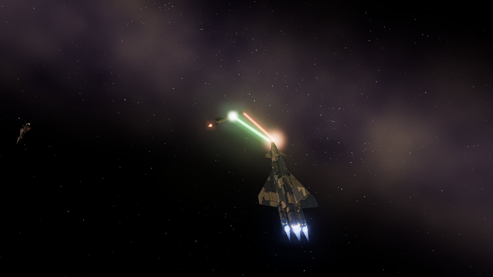

# Lodestar: Art bible

Working design, 8 November 2026. `lodestar` is a working slug; the GDD phase chooses the title.

Lodestar looks like a used, expensive machine flying through real darkness, lit by one star: weathered PBR ships, hard sunlight, deep shadow, and a quiet gold-on-black interface. It plays like a 1984 game and must never look like one. Working title; names come from the GDD.

*Real-time render of the Cheetah GLB (three.js with bloom), standing in for the game's look.*

## Pillars

Four rules decide every visual question; when two conflict, the earlier one wins.

1. **Plays the same, looks new.** Nothing on screen may echo the original's look: no wireframes, no dashboard band, no bitmap font, no copied shapes. The mechanics are retro; the picture is not.
2. **One star tells the story.** Each system is lit by its star alone. Light direction, colour and intensity come from the sim's sun, so where you are is readable from how your ship is lit.
3. **Readable at a glance.** Every ship's role must read in under a second at 300 m: silhouette first, then exhaust colour, then beacons, then tint. Effects carry gameplay meaning (whose laser, which shield) before they look pretty.
4. **Used machines.** Ships are working vehicles: layered panels, camouflage, scuffed edges, stencilled registrations, warm running lights. Nothing is glossy-new or toy-like.

## Palette

The interface is gold on near-black glass, taken from the Cheetah viewer; the world adds a small set of signal colours that always mean the same thing.

**Interface**

| Token | Hex | Use |
| --- | --- | --- |
| Void | `#0B0C0F` | Backgrounds behind panels, letterboxing |
| Glass | `#101115` at 93% | Panel fill, with a light backdrop blur |
| Rule | `#2A2C33` | Panel borders, dividers, empty gauge tracks |
| Text | `#E4E4E7` | Body text and figures |
| Dim | `#8D9099` | Secondary text, units, key hints |
| Gold | `#C9A25C` | Eyebrows, frames, selection, the reticle |
| Gold deep | `#6B5631` | Tag fills, inactive toggles, selected-row fill at 30% |
| Focus | `#9FC3FF` | Keyboard focus ring; calm condition |
| Amber | `#E8A33D` | Alert condition, heat and fuel warnings |
| Danger | `#E5484D` | Danger condition, hostile marks, critical gauges |
| Good | `#4CC38A` | Confirmations, profit, in-range |

**World signals**

| Signal | Colour | Rule |
| --- | --- | --- |
| Your lasers | Green-white `#7CFFA0` | Only your shots are green |
| Hostile lasers | Red-orange `#FF5A3C` | Anyone shooting at you |
| Police lasers | Blue-white `#8FB8FF` | Police shots, whoever they target |
| Exhaust, civilian and you | Cool blue `#6E9BFF` | Traders, hunters, your ship |
| Exhaust, pirates | Hot orange `#FF7A2E` | Read as dangerous from behind |
| Exhaust, police | White `#DDE8FF` with red `#FF3B3B` and blue `#3B7BFF` strobes | Unmistakable |
| Exhaust, aliens | Acid green `#9DFF4A` | Nothing human uses it |
| Shields | Pale cyan `#9FE3FF` | Fore and aft halves flash separately |
| Running lights | Warm white `#FFE2B0` | Every human ship |

Colour never carries meaning alone: hostile marks also change shape (a broken bracket), and police strobes also blink in a pattern, for colour-blind players.

## Ships and materials

The ACNX-7 Cheetah sets the standard: a long swept dart with twin canted tails, three engines in a tight cluster, layered hull plates and a two-tone hex camouflage. Every later ship is built to the same level and the same rig contract.

**Shape language**

- Human ships are long, flat and swept, built from layered plates with bevelled edges; turrets, bays and brakes are separate parts that visibly move.
- Each role gets its own silhouette: heavy traders are long and deep, fighters short and wide, police angular with forward-swept surfaces, escape pods round.
- Alien craft break every human rule: curved, seamless, no visible engines, light leaking from seams.
- No new model may resemble the original's ship outlines. The designer works from role briefs, never from pictures of the original.

**Materials**

- PBR: base colour, ORM, normal and emissive, on one UV set, 2048² in game.
- Paint: two-tone camouflage plus a dark under-colour, per faction. Edges and panel seams wear to bare metal.
- Markings: stencilled registration letters (the Cheetah's `ACNX`), hazard stripes at bay doors.
- Emissive: running lights and engine throats only; nothing else glows.

**Budgets**

| Class | Triangles | Moving parts |
| --- | --- | --- |
| Large ships (Cheetah) | 30–50k | Turrets, bays, brakes |
| Small ships | 10–20k | At least one: fins, canards or a turret |
| Station | 40–60k | Spin, bay doors, guide lights |
| Missiles, pods, canisters, rocks | 1–4k | Fins or none |

**Stand-in tints** (while the Cheetah plays every ship): your ship and traders keep the natural sand camo; police are multiplied toward cool grey `#C9D4E0`; pirates toward rust `#D69A88`; aliens toward dark olive `#7A9A6A`. Exhaust and beacons follow the palette.

## Light

Space is lit by one hard key light, the system's star, with almost no fill: shadows go near-black and the night side of a planet is dark except for its cities.

- **Key:** one directional light from the sun's sim position, coloured by star class (see Space). Shadows on for ships within 400 m.
- **Fill:** sky ambient at 2–4%, plus faint reflections of the starfield, enough to read a hull's outline in shadow and no more.
- **Practicals:** running lights, beacons and engine throats light their own hull through emission and, for the nearest ships, small point lights.
- **Planet shadow:** a ship on a planet's night side loses its sun term entirely; fights there are lit by engines, lasers and explosions.
- **Bloom:** only what should glow goes over 1.0. The order is fixed: sun > explosions > exhaust cores > lasers > running lights; hulls, planets and the HUD never bloom. Bloom spreads wide and soft (radius 0.5, strength 0.55), never as a hard square halo.
- **Exposure:** fixed at 1.0 with filmic tonemapping. Looking toward the sun washes the screen gently; a glare overlay with a few lens ghosts adds to it when the sun is unobstructed.
- **Hangar (docked):** the one interior. Warm strip lights overhead and around the walls, a cool rim light from behind, a polished dark floor that reflects the ship, and a glowing pad ring.

## Space

Every system looks different because everything visible is generated from that system's data: the star's class sets the light, the planet's economy and government set its look, and each galaxy has its own sky.

**Sky.** About 9,000 stars as soft round points, half of them crowded into a galactic band, over a faint dusty glow along that band. Each of the 8 galaxies has its own band angle and hue: warm amber, dusty rose, teal, violet, pale gold, sea green, rust, steel blue.

**Stars (suns).** A bright disc with slowly churning granulation, a tight hot glow and a wide faint one. Class is chosen from the system seed, for the picture only:

| Class | Colour | Feel |
| --- | --- | --- |
| Red dwarf | `#FF9A5A` | Dim, close, everything copper-lit |
| Orange | `#FFC27A` | Warm, the most common |
| Yellow-white | `#FFE8C0` | Neutral daylight |
| White | `#F4F6FF` | Harsh, high contrast |
| Blue-white | `#CFE0FF` | Cold, rare, the widest bloom |

**Planets.** A sphere with generated continents, oceans, ice caps, a separate cloud layer, an atmosphere rim on the lit side, and city lights on the night side.

| System data | Shows as |
| --- | --- |
| Economy (agricultural to industrial) | Green-blue and wet at one end, grey-brown and dry with haze at the other |
| Government (stable to lawless) | Lawless worlds get scars: dark burn patches and fewer, patchier cities |
| Tech level | City-light density and colour, from sparse amber to dense white grids; the highest add an orbital ring |
| Size | Radius |
| Inhabitants | Atmosphere tint (one of six) |

The system data panel shows the same planet, rendered and turning.

## Effects

Effects are gameplay signals first: each one says who did what to whom, in a colour from the palette and with a timing short enough to read in a fight.

| Effect | Look | Timing |
| --- | --- | --- |
| Laser, pulse | A thin bright core with a soft halo, from muzzle to target, in the shooter's colour | 0.12 s for each shot the sim fires |
| Laser, beam | The same, continuous, with a slight shimmer along its length | While firing |
| Muzzle flash | Small star at the muzzle; the turret recoils 0.3 m | 0.08 s |
| Engine exhaust | Per nozzle: a cone that fades to nothing aft, a hot core sprite at the throat; length and brightness follow speed | Continuous; flares 0.3 s on acceleration |
| Shield hit | The struck half of a faint shell (fore or aft) lights in pale cyan, brightest where hit | 0.25 s |
| Hull hit | Sparks and a brief orange scorch glow on the hull | 0.4 s |
| Explosion | White flash, fireball, glowing hull chunks in the ship's own material, a thin shock ring, then drifting debris | Flash 0.1 s, fireball 0.6 s, debris 3 s |
| Missile | Small dart with unfolding fins, a smoke-and-flame ribbon trail, a blinking seeker | Seeker blinks faster as it closes |
| E.C.M. | A pale blue sphere ripples outward from the ship; missiles caught in it flare and burst | 0.5 s |
| Area blast | Screen goes white, then every nearby ship explodes at once | 0.3 s white, then explosions |
| Jump (hyperspace) | Stars stretch into streaks around the view axis, a tunnel of light, then snap back | 2 s |
| Mid-jump ambush | The tunnel tints green and breaks off early into a dark, starless region | 1.2 s |
| Launch | The station's bay tunnel with light rings rushing past, out into space | 2 s |
| Docking guidance | The bay's lights chase inward; amber when misaligned, green when aligned | While approaching |
| Sun heat | Heat shimmer at the screen edges and an amber vignette as cabin heat rises | Follows heat |
| Beacons | Canisters blink amber, pods white, police strobe red and blue | 1 Hz, police 2 Hz alternating |

Nothing flashes faster than 3 Hz, and the area blast whiteout fades in over 80 ms rather than cutting, for photosensitive players.

## Camera and composition

Your ship is the subject of almost every frame, so the camera keeps it in the lower-middle of the screen with space and the target above it.

- **Flight:** space-anchored orbit, default 2.5× your ship's length behind and slightly above, field of view 60°. The ship sits on the lower third; the reticle and the space ahead fill the upper two-thirds.
- **Zoom:** 1.5× to 5× the ship's length. Close, the hull fills the lower half and its parts read; far, the scanner's world is visible around it.
- **Combat framing:** in follow mode the camera leans 10° toward the active mount's target, so ship and target share the frame.
- **Title:** a slow flyby past the camera with the sun behind the ship, so it reads as a silhouette with a lit rim and a blooming star.
- **Hangar:** three-quarter view from the front left at eye level with the ship's spine; the panel sits on the right, the ship on the left two-thirds.
- **Marketing stills:** the sun in the upper third, the planet low in a corner, the ship's nose pointing into the frame.

## Typography and icons

Two open-licensed typefaces, bundled with the game: **Inter** for words and **JetBrains Mono** for every number, so figures line up in tables and gauges. Both are under the SIL Open Font License. No pixel or bitmap fonts anywhere.

| Style | Face | Size at 1080p | Use |
| --- | --- | --- | --- |
| Eyebrow | JetBrains Mono SemiBold, caps, +0.4 em tracking | 12 px | `01 MARKET`, section labels |
| Panel title | Inter Bold, caps, +0.12 em | 28 px | Panel names, system names |
| Body | Inter Regular | 15 px | Descriptions, list rows |
| Figures | JetBrains Mono Regular, tabular | 15 px | Prices, quantities, distances |
| HUD label | JetBrains Mono, caps, +0.2 em | 11 px | Gauge labels |
| HUD figure | JetBrains Mono Medium | 18 px | Speed, range, credits |
| Ticker | Inter SemiBold, caps, +0.08 em | 16 px | In-flight messages |

**Icons** are line drawings, 1.5 px stroke on a 24 px grid, round caps, drawn in Gold or Text. Each is described before it is drawn:

| Icon | Description |
| --- | --- |
| Missile | A slim dart pointing up-right with two small tail fins |
| E.C.M. | Three broken concentric arcs around a dot |
| Area blast | A small ring with eight short rays |
| Fuel | A droplet inside a hexagon |
| Cargo | Two stacked crates, the top one offset |
| Shield, fore / aft | The front or back half of a ring around a small chevron |
| Energy | A lightning stroke inside a battery cell |
| Heat | Three wavy vertical lines |
| Altitude | An arc over a short horizontal line, with a down arrow |
| Legal standing | A plain shield badge, filled for clean, hatched for offender, empty for fugitive |
| Rank | One to five stacked chevrons |
| Jump | An arrow passing through a ring |
| Docking | Square brackets around a horizontal slot |
| Escape pod | A capsule with a small window |

## Sound palette

All sound is new: synthesised or recorded for this game, with no melody, cue or famous classical piece associated with the original or its genre.

| Sound | Character |
| --- | --- |
| Engine | A low hum with a soft harmonic layer; pitch and brightness follow speed, a breathy swell on acceleration |
| Your laser | A short bright filtered zap with a quick pitch drop; beam lasers a steady buzz |
| Hostile laser | Lower and harsher than yours, panned from its direction |
| Shield hit | A glassy ping, higher for fore than aft |
| Hull hit | A dull metallic thunk with a crackle |
| Missile | Bay doors clank, then a rising hiss; a lock-on tone that quickens |
| E.C.M. | A rising electronic sweep |
| Explosion | A sub-bass thump, a crackling tail, debris ticks |
| Jump | A long rising drone that cuts to silence on arrival |
| Docked | Muffled hangar ambience: distant machinery, a ventilation hum |
| UI | Soft clicks to move, a short two-note gold chime to confirm, a muted buzz to refuse |

**Music:** an original ambient score: a slow pad motif for the title and the hangar, and no music in flight except a low pulse that rises with condition red.

## Distinctiveness

No screen of ours may be mistaken for the original's. The left columns describe what made each original screen recognisable, in words only; the right column is how ours differs.

| Original screen | What made it recognisable | Ours |
| --- | --- | --- |
| Space view | Ships as white line drawings with hidden lines removed, on black, seen from the cockpit; a small cross-hair at the centre | Lit, textured, animated ships seen from a third-person camera; a gold reticle on the active mount's axis |
| Dashboard | A band across the bottom third: a column of thin labelled bar gauges on each side and an elliptical radar with vertical sticks in the middle, plus a small round compass | No band: compact instruments in the corners over the scene, a tilted 3D sphere scanner bottom-left, icons instead of two-letter labels |
| Text screens | A boxed title line at the top and plain text lists in one bitmap font on black | Glass panels over a 3D hangar, numbered gold eyebrows, real tables, two typefaces |
| Galaxy chart | A wide box filled with single-pixel dots and a cross-hair cursor, the name printed beneath | A deep-space map with star glyphs sized by system and tinted by economy, a fuel-range ring and an information card beside it |
| Local chart | System names beside circles sized by planet, inside a range circle | A zoomed map with route lines and a side list sorted by distance |
| Station | A spinning faceted polyhedron with a rectangular slot on one face | A drum-and-ring station with a lit bay, guide lights and moving doors; never faceted with a slot face |
| Launch and jump | Concentric outline shapes rushing outward | A physical bay tunnel with light rings; a stretched-star tunnel |
| Title | One line-drawn ship turning on the spot inside a frame, with a load prompt | A lit flyby against a blooming sun, the menu on glass to the side |
| Explosions | A cloud of dots expanding | Flash, fireball, glowing debris and a shock ring |

The verify role checks every contact sheet against this table before each design gate. The current one is [`contact-sheet.png`](contact-sheet.png).
