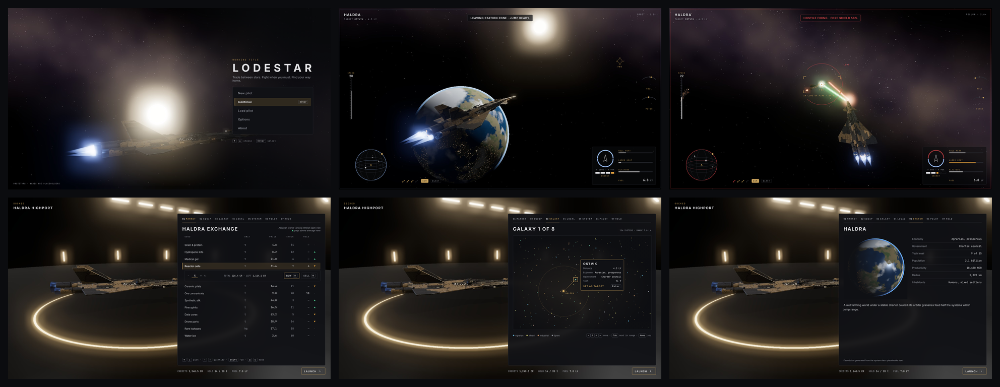
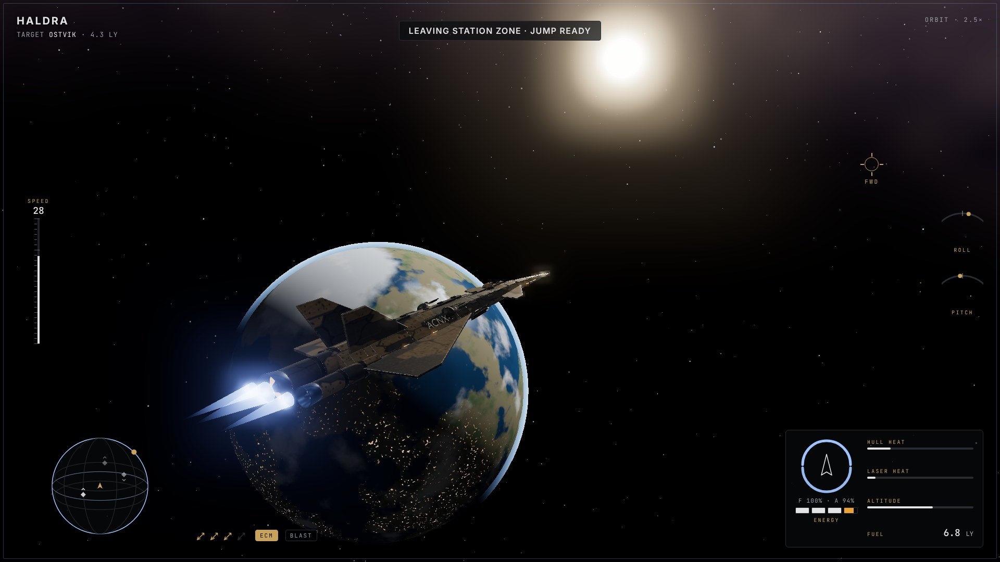
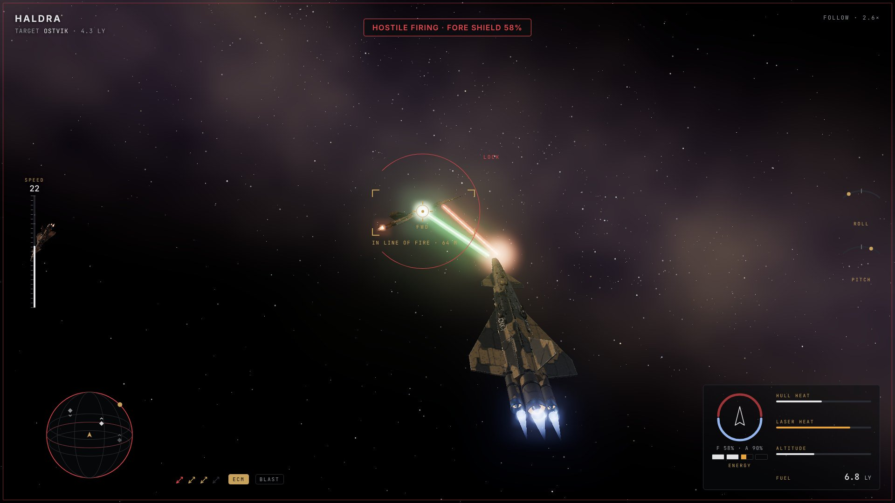
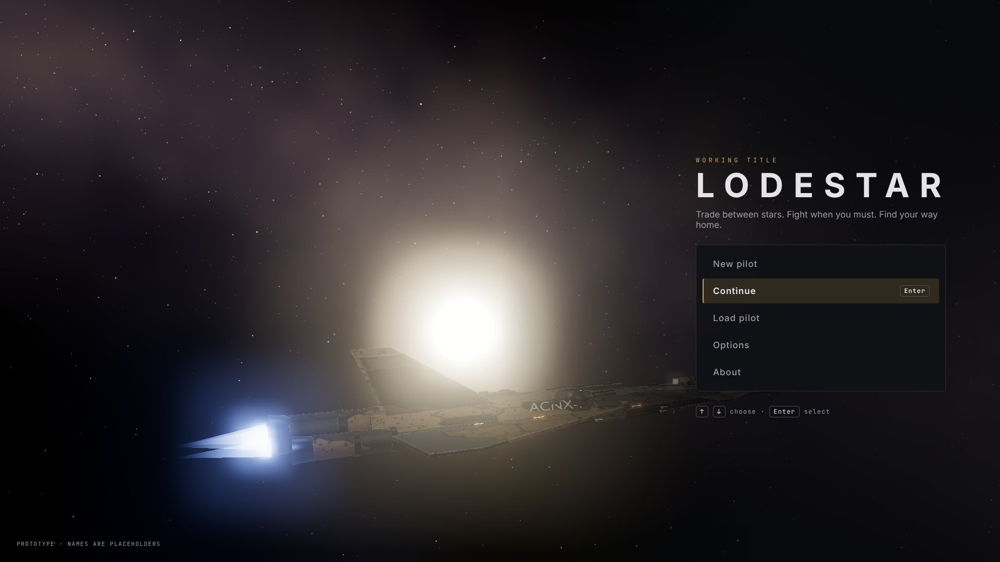
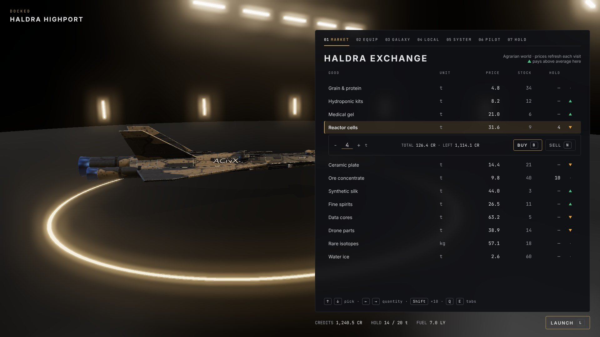
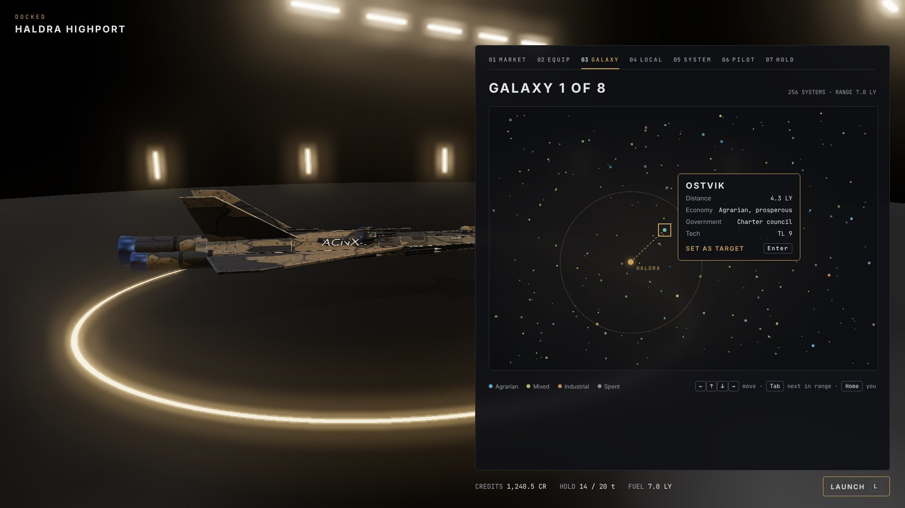
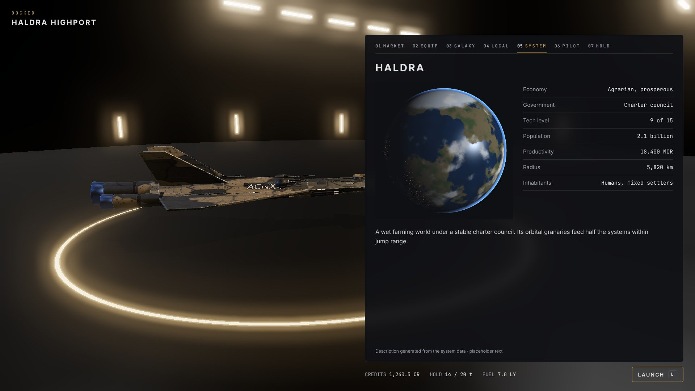

# Lodestar: UI design

Working design, 8 November 2026. `lodestar` is a working slug; the GDD phase chooses the title.

Every screen is glass panels over a live 3D scene, driven entirely from the keyboard, in the art bible's gold-on-black palette. This doc fixes the layout, components and states; sample names and goods are placeholders until the GDD names them. Example screens are in [`screens/`](screens/), with all six on [`contact-sheet.png`](contact-sheet.png).

## Tokens

Colours and typefaces are the art bible's; this adds the measures every component uses. All sizes are at the 1920×1080 reference and scale with the window.

| Token | Values |
| --- | --- |
| Spacing | 4-px grid: 4, 8, 12, 16, 24, 32, 48 |
| Safe margin | 32 px from every screen edge |
| Radius | Panels 6 px; buttons, rows and chips 4 px; pips round |
| Borders | 1 px Rule; selected or focused 1 px Gold; keyboard focus adds a 2 px Focus ring 2 px outside |
| Panel | Glass fill, 12 px backdrop blur, 1 px Rule border, no shadow |
| Motion | Fast 120 ms (hover, selection), medium 200 ms (panel slide, tab change), slow 320 ms (screen change); ease-out; none longer |
| Layers | 3D scene → world markers (reticle, brackets) → HUD → panels → modal → toasts → focus-lost card |

## Layout and scaling

The UI is designed at 1920×1080 and scaled uniformly to the window's height; wider windows gain empty space at the sides, never wider panels.

- **Godot setup:** stretch mode `canvas_items`, aspect `expand`, base size 1920×1080, minimum window 1280×720. HUD elements anchor to corners and edges; panels anchor to the centre column.
- **Centre column:** docked panels are 880 px wide on the right (x 1008–1888), so the ship in the hangar stays visible on the left.
- **UI scale option:** 80%, 100%, 125% and 150%, applied on top of the window scale.
- **Ultrawide (21:9 and up):** HUD corners stay in a 16:9 safe area centred on the screen; the 3D view fills the rest.
- **Desktop only.** No touch layout in the first release.

## Components

A small kit builds every screen; each has the states listed and nothing else.

| Component | Look | States |
| --- | --- | --- |
| Panel | Glass, 6 px radius, 24 px padding, eyebrow then title at the top | Open, closing (slides 16 px and fades, 200 ms) |
| Eyebrow | Two-digit number on a Gold-deep chip, then the label in Gold: `01 MARKET` | — |
| Tab bar | Eyebrow-style tabs in a row; the active tab has a 2 px Gold underline | Active, inactive, focused |
| List row | 44 px tall, figures right-aligned in mono; a 2 px Gold bar on the left when selected | Normal, selected, disabled (Dim text, ⊘ icon), warning (Amber figure) |
| Quantity stepper | `−  12  +` in mono with the unit after; ←→ change by 1, `Shift` by 10, digits type a value | Normal, at limit (the limit's side dims), invalid (Danger outline) |
| Button | Text in caps, 1 px Rule border, 40 px tall; the primary one has a Gold border and a key chip | Normal, focused, pressed, disabled |
| Key chip | The key in mono on a 1 px Rule box: `[Enter]` | Normal, pressed (fills Gold-deep for 120 ms) |
| Bar gauge | 4 px track in Rule, fill in Text; label above, figure right | Normal, warning (Amber), critical (Danger, pulses at 1 Hz) |
| Arc gauge | 90° arc, 3 px, same colours as the bar | Same |
| Pip row | Small circles or icons, filled or hollow | Filled, hollow, active (Gold), locked (Danger) |
| Badge | Icon plus 2–4 letter label in a 4 px-radius chip | Off (Rule border, Dim), on (Gold fill) |
| Ticker | One line of caps text at top centre on a thin glass strip | Appears 120 ms, holds 3 s, fades 320 ms; urgent messages hold 5 s and tint Danger |
| Modal | Small panel centred, dims the screen to 60% | Confirm, cancel |
| Info card | A small panel attached to a selected item on a map | — |

## Flight HUD

The HUD keeps the centre of the screen for your ship and its target, and puts everything else in four quiet corners plus two thin instruments on the side edges. Positions are at 1920×1080.

| Element | Place and size | Content and states |
| --- | --- | --- |
| Location | Top left, 32 px in; 360 × 48 | Current system name (Panel title style, 20 px) over the target system and its distance in light years (Dim, mono). `SAFE ZONE` badge appears beside the name inside the station's zone |
| Ticker | Top centre, y 40; up to 720 × 36 | One message at a time, caps, max 40 characters |
| Camera hint | Top right, 32 px in | Camera mode and zoom (`ORBIT · 2.5×`), fades 3 s after the last camera input |
| Reticle | Where the active mount's axis is 800 m out, or, when a ship is in the line of fire, at that ship's range, so the reticle sits on it despite the camera's parallax | Gold ring 28 px with four ticks; mount tag below (`FWD`, `AFT`, `PORT`, `STBD`). A ship in the line of fire gets solid corner brackets and the ring's centre fills |
| Missile marks | On the targeted ship | Seeking: an Amber ring turning once a second; locked: a Danger ring and a fast tone |
| Speed tape | Left edge, x 72, y 420–660 (clear of the ship) | Vertical bar of 24 ticks, fill shows speed, figure above in HUD-figure style |
| Rate arcs | Right edge, x 1808, y 470 and 590 | Roll and pitch: 90° arcs with a moving notch, centre mark at zero |
| Scanner | Bottom left, 32 px in; 320 × 230 | A tilted 3D sphere with a grid floor; contacts as small diamonds inside the sphere, dimmer with depth, with a tiny ▲ or ▼ chevron for above or below your plane and no height lines (a radar with vertical sticks is the original's look); a heading pip on the rim. The sphere's rim tints by condition: Focus (calm), Amber (alert), Danger (red); Gold when docked |
| Weapons row | Right of the scanner, x 376–700, y 1004 | Missile pips (up to 4), then the `ECM` and `BLAST` badges; lit when fitted and ready |
| Ship status | Bottom right, 32 px in; 380 × 230 | A small ship icon inside a ring split fore and aft (shields); four energy cells under it; bars for hull heat, laser heat and altitude; fuel in light years as a figure |
| Key hints | Bottom centre, y 1030 | `[1-4] MOUNT  [Q] TARGET  [E] FIRE MISSILE`, shown on the first three launches, then off; every key stays listed under Pause → Controls |

**Condition** is also shown by a 1 px frame line around the screen's edge in the condition colour, at 30% opacity, so it reads in peripheral vision.

**Assists on:** contacts on the scanner use the art bible's faction colours, and every ship in view gets thin corner brackets with its type and range in metres; hostiles off screen get an edge arrow.

## Screens

Each screen below lists its regions, what they hold, and its keys (Modern layout; Classic as in the design doc). Example renders of the starred ones are in [`screens/`](screens/).

### Title ★

The title flyby fills the screen. The menu sits on the right third, clear of the ship and its exhaust: the game's title (Panel title, 64 px, +0.3 em), a one-line strapline in Dim, then a vertical menu: **New pilot**, **Continue** (last save), **Load pilot**, **Options**, **About**. ↑↓ and `Enter`. The About panel holds the credit line `create-retro-game` requires.

### Flight ★

The HUD above over the live scene. Combat ★ is the same screen with brackets, missile marks, a Danger condition frame and messages.

### Pause

The scene freezes and dims to 40%. A centred 480 px panel: **Resume**, **Options**, **Controls**, **Quit to title** (asks to confirm; unsaved progress since docking is lost, as in the original rules).

### Docked: the station hub ★

The hangar scene fills the screen, with your ship on the left two-thirds. One panel on the right (x 1008–1888, y 96–1000) with a tab bar across its top: `01 MARKET`, `02 EQUIP`, `03 GALAXY`, `04 LOCAL`, `05 SYSTEM`, `06 PILOT`, `07 HOLD`. `Q`/`E` or digits switch tabs. Below the panel, a bar: station and system name on the left, credits and cargo space on the right, and the primary button **Launch** `[L]`. Saving is on the Pilot tab.

| Tab | Regions | Keys |
| --- | --- | --- |
| 01 Market ★ | Table of goods: name, unit, price here, available, in hold, and a trend arrow (up if this economy pays above average). The selected row expands into a stepper with Buy and Sell, and the total and remaining credits beneath | ↑↓ pick, ←→ quantity, `B` buy, `N` sell, `Shift` ×10 |
| 02 Equip | Two columns: items available here (name, price, one-line effect) and your fitted equipment. Buying a laser asks which mount on a small diagram of the ship | ↑↓, `Enter` buy, mount picker ←→ |
| 03 Galaxy ★ | The whole galaxy as a dark map: stars as glyphs sized by system, tinted by economy; the fuel-range ring around you; the cursor and an info card for the selected system (name, distance, economy, government, tech, a jump button) | Arrows move the cursor, `Enter` select, `Home` back to you, `Tab` cycles systems in range |
| 04 Local | The neighbourhood within twice your range: route line to the target, names beside the stars; a side list of systems in range sorted by distance | Same as Galaxy |
| 05 System ★ | The planet rendered and turning on the left; on the right the data: economy, government, tech level, population, productivity, radius, inhabitants, with small icons; a two-line description written from the data | — |
| 06 Pilot | Pilot name, rank (chevrons and title), legal standing, kills, credits, fuel, present and target systems, equipment list, and Save pilot | `S` save, `Enter` on export/import |
| 07 Hold | Cargo by item with units and quantity, hold capacity bar | — |

### In-flight panels

`G`, `L`, `I`, `O`, `V` and `Y` open the Galaxy, Local, System, Market prices (read-only), Pilot and Hold panels over the flight view, full-size, with the HUD still visible below. The sim keeps running; the panel shows a small Danger strip at its top edge when the condition is red. `Esc` or the same key closes.

### Options

Tabs: **Graphics** (preset, MSAA, glow, shadows, texture size, render scale), **Audio** (master, effects, music, UI), **Controls** (layout, the action list with rebinding, mouse orbit sensitivity), **Camera** (mode, default zoom), **Interface** (UI scale, assists, reduced motion, colour-blind marks).

### Death

The camera pulls back from your ship's explosion for 3 s, the screen slowly desaturates, then a centred panel: a one-line epitaph written from how you died, your rank and kills, and **Restart from last save** or **Title**.

### Transitions

Launch (bay tunnel, 2 s), jump (star tunnel, 2 s), docking (the bay doors close behind you, cut to the hangar). Each can be skipped with `Enter` after the first time.

## Flow between screens

Three places hold the player (title, flight, docked) and everything else is a panel or transition on top of one of them.

| From | Input or event | To |
| --- | --- | --- |
| Title | New pilot / Continue / Load pilot | Docked hub, Market tab |
| Docked hub | `L` Launch | Launch transition → Flight |
| Docked hub | `Esc` | Pause |
| Flight | `G` `L` `I` `O` `V` `Y` | The matching in-flight panel (sim keeps running) |
| Flight | `Esc` / `P` | Pause (sim frozen) |
| Flight | Docking checks pass | Docking transition → Docked hub, Market tab |
| Flight | `H` with a target in range, countdown ends | Jump transition → Flight in the new system |
| Jump | Ambush | Ambush transition → Flight in deep space |
| Flight | Ship destroyed | Death → Docked hub (last save) or Title |
| Pause | Options / Controls | Options panel (Controls tab) |
| Pause | Quit to title, confirmed | Title |
| Any | Canvas loses keyboard focus | Paused, with the "Click to continue" card |

## Text rules and budgets

All words live in one text table and are written fresh to these budgets; none is a paraphrase of the original's messages.

- **Voice:** terse, plain, a little dry; a ship's computer that respects you. No exclamation marks except for a kill confirmation.
- **Case:** HUD and eyebrows in caps; panels in sentence case.
- **Numbers:** always mono and right-aligned; credits with one decimal (`1,240.5 CR`), distances in light years with one decimal, speed as a whole number.

| Text | Budget | Example (placeholder) |
| --- | --- | --- |
| Ticker message | 40 characters, 1 line | `MISSILE INBOUND — ECM READY` |
| System name | 12 characters | `HALDRA` |
| Goods name | 18 characters | `Reactor cells` |
| Equipment name | 22 characters | `Fuel scoop array` |
| Equipment effect | 60 characters, 1 line | `Draws fuel from a star's corona while you skim it.` |
| System description | 2 lines of 70 characters | Generated from the system's data |
| Rank title | 14 characters | Named in the GDD |
| Epitaph | 1 line, 60 characters | Generated from the cause of death |

Sample names on the example screens (`Haldra`, `Ostvik`, the goods list) are placeholders, invented for the mock-ups; the GDD replaces them.

## Accessibility

The game is keyboard-first by nature; these rules make it usable for players with low vision, colour-vision differences and motion or flashing sensitivity.

- **Contrast:** text at least 4.5:1 against the glass over the brightest likely background (the sun's halo); gold labels at least 3:1 at their size.
- **Colour is never alone:** hostile marks are broken brackets, police strobes blink in pairs, gauge warnings add a pulse and an icon.
- **Colour-blind marks** (option): adds letters to scanner contacts and swaps the green/red laser pair for cyan/orange.
- **Flashing:** nothing above 3 Hz; the area-blast whiteout fades in over 80 ms; a **Reduced motion** option shortens transitions to a cut and turns off camera shake and lens ghosts.
- **Scale:** UI scale up to 150%; HUD figures never below 14 px at 100%.
- **Input:** every action remappable; nothing needs two keys at once except optional `Shift` modifiers; holds (escape pod) can be set to a toggle.
- **Screen readers:** the Godot web canvas is not reachable by screen readers, so every panel also mirrors its text into an off-screen live region of the page for the selected row and the latest ticker message.
