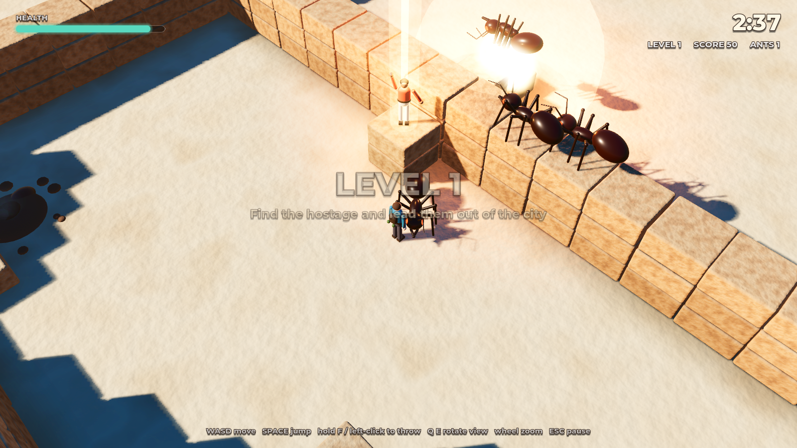

# Swarmhold



*The city has fallen to the swarm. Someone is still inside.* A single-player rescue game made in Godot 4 for the web. Get into a walled desert city overrun by giant ants, find the last person left in it and lead them out through a gate before time runs out.

It lives at <https://icelander.net/games/retro/swarmhold/>. Like every game on icelander.net/games it needs a sign-in, with Google or GitHub, through icelander.net's login service.

Swarmhold is an original game in the genre of the isometric city-rescue games of the early 1980s. Its city, characters, art, text and code are its own: everything you see is generated by its scripts, and the only file it ships that it didn't make is the Montserrat font (SIL Open Font License, `godot/fonts/OFL.txt`).

## How to play

- **WASD** or the arrow keys move you, relative to the camera. **Space** jumps: you can climb one block at a time.
- **Hold F** or the left mouse button to aim a grenade (the arc shows where it lands), and let go to throw. Hold longer to throw farther. Grenades kill ants, but they hurt you and the hostage too.
- **Q** and **E** turn the view a quarter turn, the mouse wheel zooms and **Esc** pauses.
- The hostage stands under a beam of light, and the gold arrow over your head points to them. Reach them and they follow your footsteps, jumping where you jumped. Then the arrow points to the nearest gate.
- The ants come out of nests inside the city, find their way to you around the blocks, climb one block at a time and bite you and the hostage.
- Every level is a new city, with more and faster ants and less time. The score counts ants killed, and a rescue bonus for the time left and the hostage's health.

## How it works

```
godot/                  the game (Godot 4.7, GDScript, Compatibility renderer for WebGL 2)
  scripts/main.gd       game flow, lighting and sky, camera, spawning, explosions, the autotest
  scripts/city.gd       city generation, the grid, path fields for the ants, block meshes and collision, baked ground shading
  scripts/player.gd     the player: movement, jumping, aiming and throwing, the objective arrow
  scripts/hostage.gd    the hostage: waits under its beacon, then follows the player's footsteps
  scripts/ant.gd        an ant: follows the path field, climbs by jumping, bites; its model and gait
  scripts/grenade.gd    a grenade: physics, fuse, blinking light
  scripts/humanoid.gd   the people's procedural models and walk cycle
  scripts/fx.gd         explosions, smoke, debris, scorch marks and dust
  scripts/meshes.gd     bevelled stone blocks, noise textures and materials
  scripts/hud.gd        the HUD, messages and title screen
  fonts/                Montserrat (SIL OFL)
  web_shell/shell.html  the page the web export runs in
web/                    boot.js (starts the engine), shell.css, favicon.svg, _headers
worker/index.ts         the Cloudflare Worker: the page behind the sign-in, the joined engine file, static assets
test/                   the Worker's tests
```

The game keeps nothing on a server: no API, no database, no high scores. Godot's WebAssembly engine is larger than the 25 MiB Cloudflare allows for a static file, so the build stores it as `index.wasm.0` and `index.wasm.1` and the Worker streams them back as one `index.wasm`, as Gambit and Hedgerow do.

## Develop

You need Node 22 and [Godot 4.7.2](https://godotengine.org/download) with its web export templates (set `GODOT` to its path if it isn't on the PATH as `godot`).

```bash
npm install
npm test                 # the Worker
npm run test:godot       # three levels played through headless: rescue, ants, grenades, exits; fails on any miss
npm run dev              # exports the game, then wrangler dev at http://localhost:8787/games/retro/swarmhold/
```

Run it from the Godot editor with `godot/project.godot`. `godot --path godot -- --shots=/tmp/shots` renders a few reference frames to PNG files and quits.

## Deploy

A merge to `main` that changes this folder deploys it (the repository README, "Deploying"). By hand: `npm run deploy`. No database, secrets or one-time set-up.
