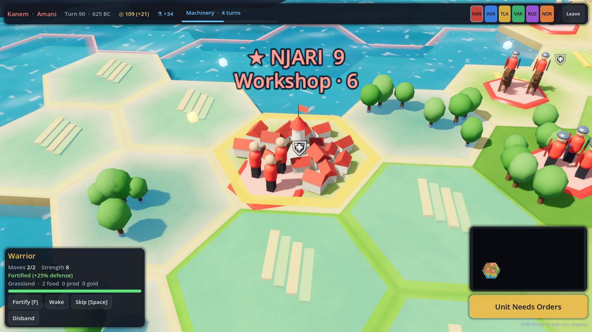
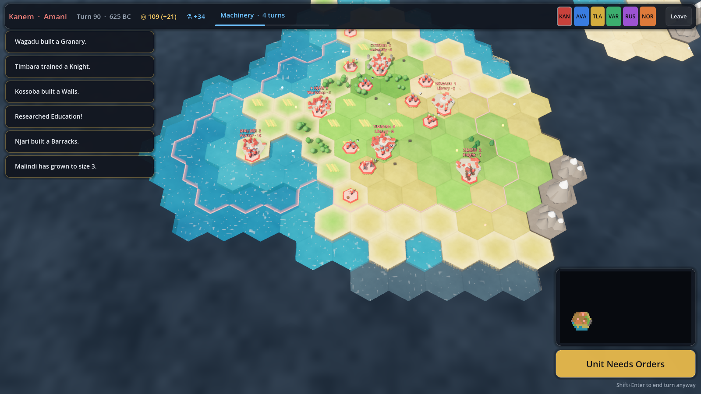

# Twelve Banners



A hex-based 4X strategy game made in Godot 4, **under construction**. Found cities, work the land, research from
Agriculture to Space Flight, and outlast up to eleven rival civilizations, played by friends or by the computer.

It lives at <https://icelander.net/games/fresh/twelve-banners/>, **for invited players only**: every file, the landing
page included, is served only to someone signed in to icelander.net who holds the role `games:twelve-banners`. The
role is declared in the icelander.net repository (`accounts/src/config.js`) and granted, or sent as an invitation, at
<https://icelander.net/private/admin>. The games page lists it under *Under construction*, and only to holders of the
role.

It is played two ways:

- **In the browser** (`/games/fresh/twelve-banners/play/`): Godot's web export on the Compatibility renderer
  (WebGL 2), against the computer. A browser has no UDP, so the menu leaves out Host and Join there (`Net.CAN_HOST`).
- **As a download** (`/games/fresh/twelve-banners/download/`): Windows (x86_64), macOS (universal) and Linux
  (x86_64) builds on the Forward+ renderer, with ambient occlusion, and **online games for up to 12
  civilizations**. They aren't code-signed.

There are no art assets: the terrain, water, trees, units and cities are built in code from meshes and shaders.



## Playing together (desktop builds)

One player chooses **Host Game**; the lobby shows the addresses the others **Join Game** at (UDP port 24565, which
has to be forwarded on the host's router for play over the internet). The host sets how many seats the computer
plays (12 civilizations at most) and the map size. Everyone moves at the same time, and the turn ends when every human
has pressed End Turn. If a player drops out, the computer takes over their civilization. C opens the chat.

The host is authoritative and every peer runs in deterministic lockstep:

1. A player's action becomes a *command* (`move`, `attack`, `found`, `prod`, …) sent to the host.
2. The host checks it against the rules (`Game.resolve`), rolls any dice (combat damage), and turns it into
   *events*.
3. The host broadcasts the events in order, and every peer, the host included, applies them with `Game.apply`, which
   uses no randomness. The map is generated only on the host and sent when the game starts.

The self-test feeds a second copy of the game only the host's events through 100 turns of an eight-civilization game
and checks that both stay identical every turn.

## How to play

| | |
|---|---|
| Cities | Found cities with Settlers (B). They grow on surplus food, work their best tiles and build units, buildings, Wealth or Research; gold buys production. |
| Land | Workers build farms, mines and trading posts. Borders grow when a city reaches size 3. |
| War | Right-click to move or attack; hover first for the path or the odds. Cities defend and bombard nearby enemies; one at 0 HP falls to a melee attack. |
| Win | Be the last civilization standing, launch the Spaceship from your capital after Space Flight, or have the highest score on turn 300. |
| Camera | WASD, arrow keys, the screen edge or middle-drag to pan, wheel to zoom, Q / E to rotate, H for the capital. |
| Keys | Enter ends the turn (it first takes you to anything waiting for orders; Shift+Enter ends it anyway), T the technologies, F fortify, Space skip, Tab the next unit. |

Rules and balance live in `godot/scripts/Defs.gd` (terrain, units, buildings, technologies) and
`godot/scripts/Game.gd` (yields, growth, combat).

## How it works

```
godot/                      the game (Godot 4.7; Forward+ on the desktop, Compatibility on the web)
  scripts/Defs.gd           terrain, resources, improvements, units, buildings, technologies, civilizations
  scripts/Hex.gd            pointy-top hex maths in odd-r offset coordinates
  scripts/GameTypes.gd      Unit, City and Player
  scripts/Game.gd           the rules: resolve() on the host, apply() on every peer, turn resolution, victory
  scripts/MapGen.gd         the continent generator and start positions (host only)
  scripts/AI.gd             the computer players, which send ordinary commands
  scripts/Net.gd            autoload Net: the ENet lobby, the command/event relay and the turn flow
  scripts/WorldView.gd      the 3D world: terrain mesh, water, decorations, borders, fog of war, units, cities, effects
  scripts/Models.gd         the units and buildings, built from primitives
  scripts/CameraRig.gd, Hud.gd, Menu.gd, UiTheme.gd, Main.gd   camera, interface, menu and lobby, input
  shaders/                  terrain, water and decorations, and the shared hex and fog-of-war include
  tests/selftest.gd         headless test: rules, lockstep, a twelve-civilization game, the scene
  web_shell/shell.html      the page the web export runs in (no inline script: the CSP forbids it)
  export_presets.cfg        Web, Linux, Windows and macOS
web/                        the landing page, the play page's stylesheet and boot script, the icon, _headers
worker/index.ts             the Worker: games:twelve-banners on every file but the stylesheet and icon; joins parted files
worker/config.ts            the game's path and role
test/worker.test.ts         who may fetch what, and the joining of parts
build.mjs                   exports everything into dist/, zips the desktop builds and cuts large files into parts
```

Cloudflare serves static files of at most 25 MiB. The engine (`index.wasm`) and the desktop zips are stored as
20 MiB parts (`name.0`, `name.1`, …), and the Worker streams the parts back as one file, as Iron Haze does.

## Commands

Requires Node 22, and Godot 4.7.2 with its export templates for the builds (set `GODOT` to its path if it isn't on
the PATH as `godot`).

| Command | What it does |
|---|---|
| `npm test` | Typecheck and the Worker's tests |
| `npm run test:godot` | Import the project and run the headless self-test |
| `npm run build` | The landing page, the web export and the three desktop builds, into `dist/` |
| `npm run build:web` | The landing page and the web export only |
| `npm run dev` | `build:web`, then `wrangler dev`. For the stand-in sign-in put `DEV_LOGIN="1"` in `.dev.vars` and run `npx wrangler dev --local-upstream localhost:8787`, with a `site_session` cookie of `dev.` and base64url JSON such as `{"email":"you@example.com","roles":["games:twelve-banners"]}` |
| `npm run deploy` | Test, build and deploy by hand (normally the merge to `main` does it) |

Developer flags for the Godot project, after `--` on its command line: `--autotest N --players P` (the computer plays
P civilizations for N turns and prints each turn), `--host-test` and `--join-test` (two bot players over ENet on this
computer, printing `SYNC` checksums to compare), and `--shot N DIR` (play N turns, then save screenshots; needs a
display).

## Not yet

Online play in the browser, saved games, diplomacy (everyone is at war; the computer holds off for 20 turns), naval
units, roads and rivers. See `.dev/backlog.json`.

## Deploy

A merge to `main` that changes this folder deploys it (`.github/workflows/deploy.yml`, which installs Godot 4.7.2 and
its export templates for the Godot games). The Worker needs no database and no secrets: only the route
`icelander.net/games/fresh/twelve-banners*` and the service binding to the login service, both in `wrangler.jsonc`.
